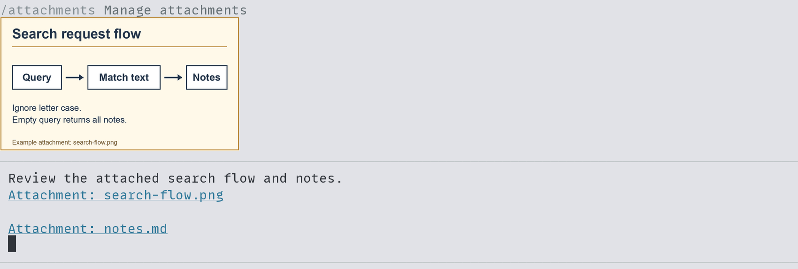
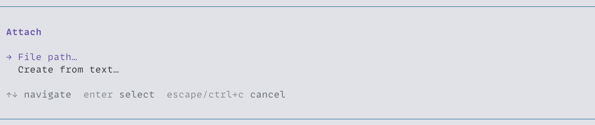
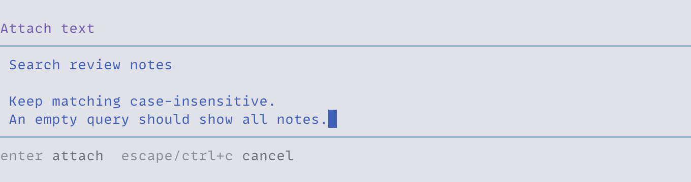
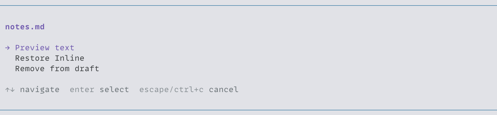
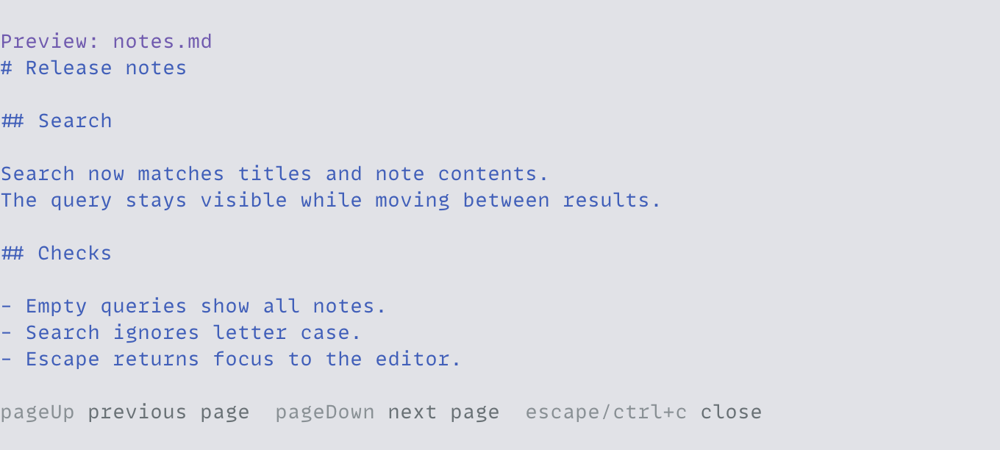
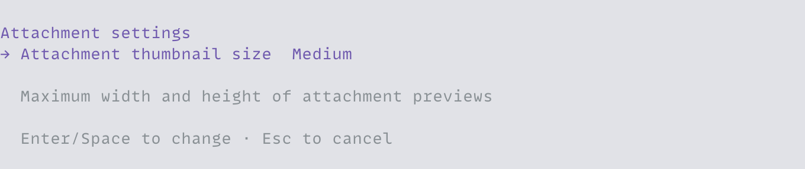

<h1 align="center">pi-attachments</h1>

<p align="center">Paste files, images, and long text into Pi as saved attachments.</p>

<p align="center">
  <a href="#install">Install</a> ·
  <a href="#attach-content">Attach content</a> ·
  <a href="#manage-attachments">Manage attachments</a> ·
  <a href="#recovery-and-storage">Recovery and storage</a>
</p>



Shown with [pi-composer](../pi-composer).

## Install

Requires Node.js 24+ and Pi/TUI 1.1.0+ (1.x). From the repository root:

```bash
pi install ./packages/pi-attachments
```

The package works with Pi's native editor and [pi-composer](../pi-composer). If you use the composer, load it first. The supported terminal setup is fullscreen Pi in Ghostty on local macOS.

If `pi-paste` is installed, remove it with `pi remove ./packages/pi-paste`. Existing attachment snapshots and paste recovery files remain usable. Run `/reload` in an open Pi session.

## Attach content

Run `/attach` or press `Ctrl+Alt+F` to open the attachment menu. Choose File path to enter a path, or Create from text to save text literally, including short text and paths.





For copied files and images, use Pi's clipboard action (`Ctrl+V` by default). With PastePal, choose Copy, return to Pi, then use that shortcut. Ghostty's `Cmd+V` sends terminal text.

| Content                                        | What happens                                                              |
| ---------------------------------------------- | ------------------------------------------------------------------------- |
| Copied files or a clipboard image              | Saved as attachments. Copied files take priority over clipboard images.   |
| One readable file path                         | The file is captured. Relative paths use the session's working directory. |
| Other text under 5,000 UTF-16 code units       | Inserted inline.                                                          |
| Other text at or above 5,000 UTF-16 code units | Saved as a `paste.txt` attachment.                                        |

Markdown links to local files also capture their targets. Links inside code and remote links do not become attachments. Text and file attachments give the agent a saved path to read; images are sent as image content. Changing or deleting the original file leaves the saved copy intact.

## Manage attachments

Press `Ctrl+Alt+A` while composing, or run `/attachments`, then choose an attachment.



| Action            | What happens                                                                                                              |
| ----------------- | ------------------------------------------------------------------------------------------------------------------------- |
| Preview text      | Opens the saved UTF-8 text in a read-only, scrollable view.                                                               |
| Restore Inline    | Inserts the saved text at the caret or over the selection, then removes all references to that attachment from the draft. |
| Remove from draft | Removes all references to that attachment from the draft.                                                                 |

With `pi-composer`, restoration and removal can be undone. Both actions keep the saved file.



Choose Settings in the manager to set thumbnail size to Small, Medium (the default), or Large. Click an image preview to open the saved file. If you edit it in another app, save changes to a different file to preserve the captured copy.



Remap the shortcuts with `extension.attachments.attach` and `extension.attachments.manage` in Pi's `keybindings.json`. Run `/reload` after editing it.

## Recovery and storage

Snapshots and recovery files live under `pi-attachments/` in Pi's agent directory, including with `--no-session`. If a capture fails, Pi reports the error and any recovery path. Run `/attachments-recover` (also `/paste-recover`) to retry retained reads and saves. Recovery does not insert content into the current draft.

`/attachments-cleanup` removes only unused staging files. Saved attachments and recovery records do not expire. If saving still fails, content held only in memory is lost when Pi exits.

See the [specification](../../docs/specs/pi-attachments.md) for paste rules, image handling, and recovery details.
