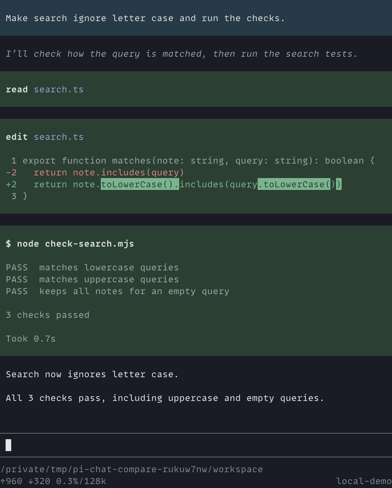
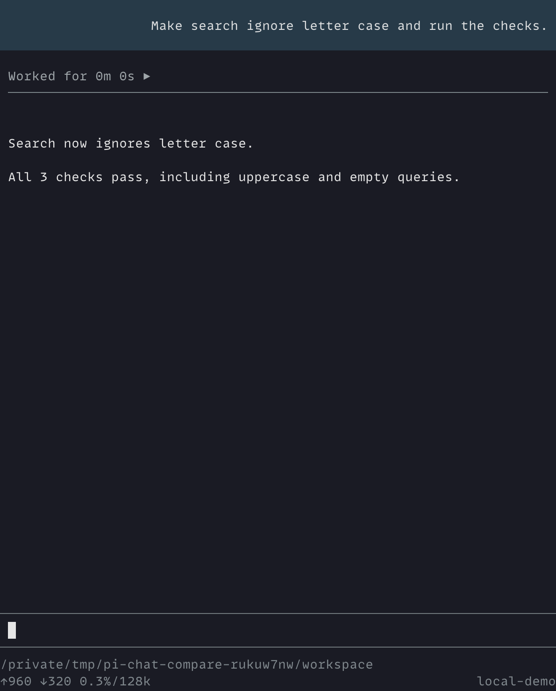
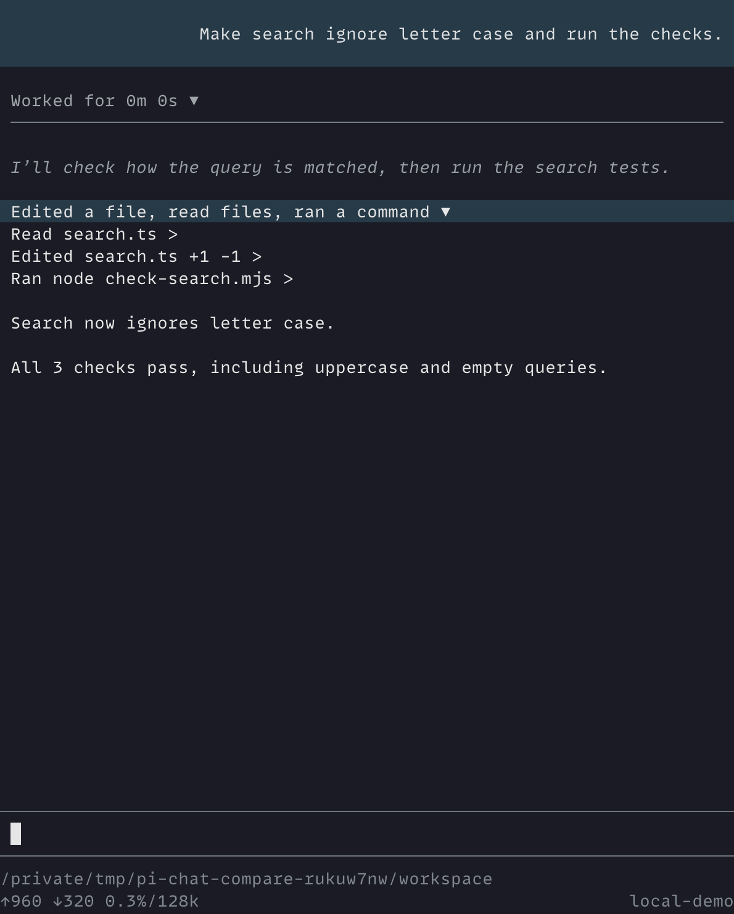
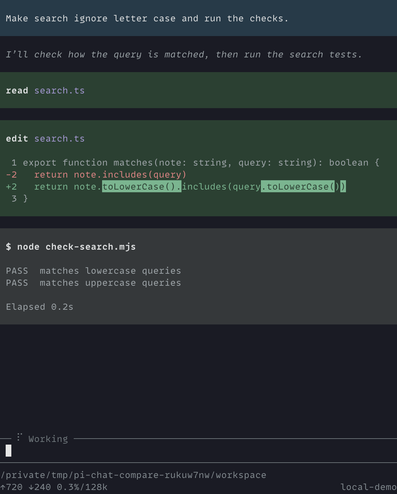
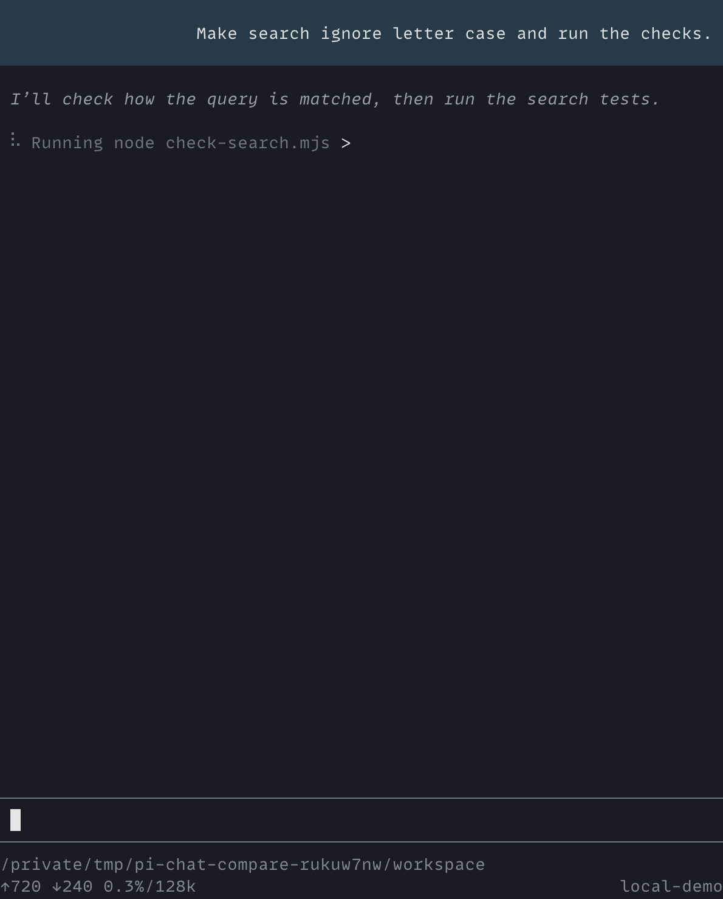
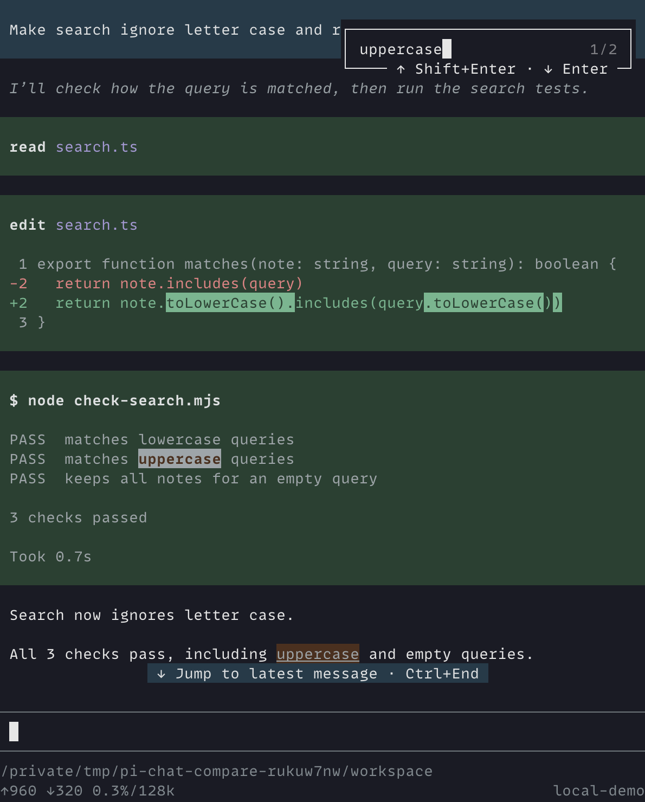
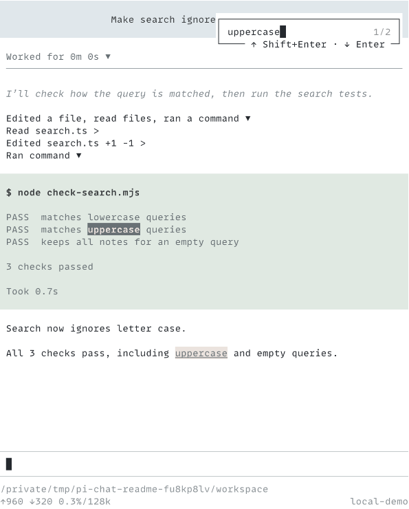

<h1 align="center">pi-chat</h1>

<p align="center">Keep Pi readable when the output piles up.</p>

<p align="center">
  <a href="#install">Install pi-chat</a> ·
  <a href="#read-activity">Read activity</a> ·
  <a href="#find-text">Find text</a>
</p>

A small change in native Pi can leave you scrolling past file contents, diffs, and command output to find the answer. The longer the session runs, the more attention it takes just to keep your place.

pi-chat lets you choose how much of that work to read. Scan short summaries to follow progress, then open the steps you want to check. By default, earlier activity folds away when the final response arrives, leaving the answer in view. You can focus on the response and bring back details as you need them.

| Vanilla Pi                                                                            | pi-chat                                                                                 |
| ------------------------------------------------------------------------------------- | --------------------------------------------------------------------------------------- |
|  |  |

Both views show the same conversation: one file read, one edit, and a test run. Even this small task fills most of the native Pi view with tool activity. pi-chat folds that work into the "Worked for" row above the answer, ready to reopen.

## Install

Requires Node.js 24+ and Pi/TUI 1.1.0+ (1.x). From the repository root:

```bash
pi install ./packages/pi-chat
```

In an open Pi session, run `/reload`. Use fullscreen mode with Pi's native editor or [pi-composer](../pi-composer).

Install [pi-copy](../pi-copy) separately for copy controls. Either load order works. [pi-quote](../pi-quote) adds quoting from selected conversation text.

## Read activity

Keep an eye on progress without opening every tool result. Group summaries show what the agent has done; the working row shows its current operation or thought. You can stay with this overview until something needs a closer look.

### Review the steps

Both views show the finished task, with pi-chat's activity group open to show each step.

| Vanilla Pi                                                                         | pi-chat                                                                                                |
| ---------------------------------------------------------------------------------- | ------------------------------------------------------------------------------------------------------ |
|  |  |

To check the work, click a group header, then expand an item to inspect its command, file change, or result. Click the same header to fold it away again. The "Worked for" row reopens earlier activity above the final answer.

Press `Alt+G` to focus a nearby control. Use Pi's selector keys: Up/Down to move, Enter to open or close, and Escape to return to the editor. Your configured bindings take priority.

Pi's Hide thinking setting controls whether thoughts appear.

### While a command runs

Both views show the checks still running. pi-chat keeps the current command in one row; open it when you want to see the output.

| Vanilla Pi                                                                                | pi-chat                                                                            |
| ----------------------------------------------------------------------------------------- | ---------------------------------------------------------------------------------- |
|  |  |

## Find text

When you return to a long session, search for the command or output you need. Open Pi's Find (`Ctrl+Shift+F` by default on macOS) and select a match. pi-chat opens the relevant activity, even inside a closed group, without running tools again.

Both views show the same search for `uppercase`.

| Vanilla Pi                                                                               | pi-chat                                                                                                          |
| ---------------------------------------------------------------------------------------- | ---------------------------------------------------------------------------------------------------------------- |
|  |  |

Search covers the text Pi has retained for the current session branch, including text from before compaction and text hidden by a tool's display. Output that was never retained cannot be recovered by search.

See the [specification](../../docs/specs/pi-chat.md) for grouping and search behavior.
