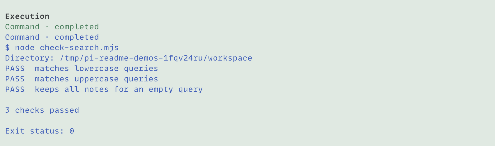
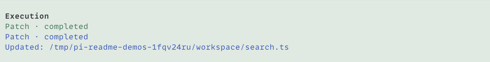
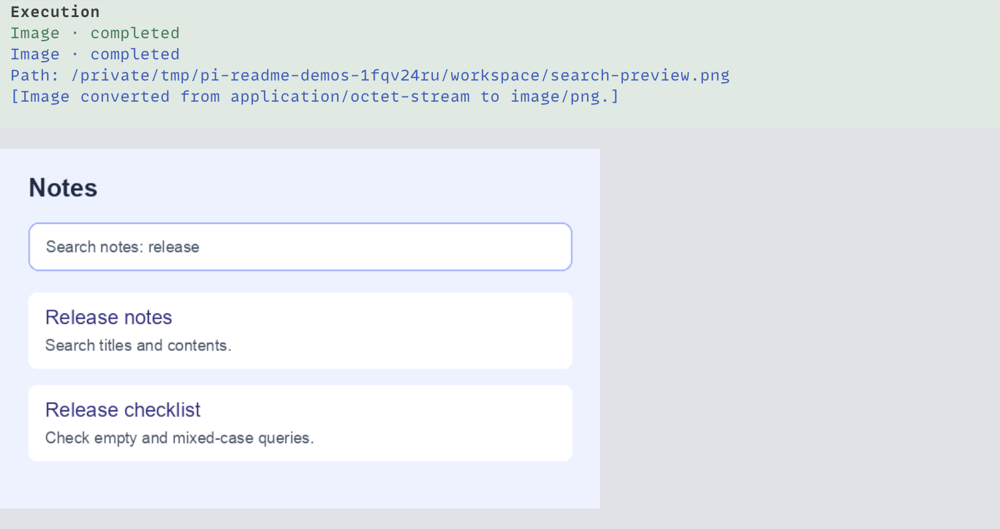
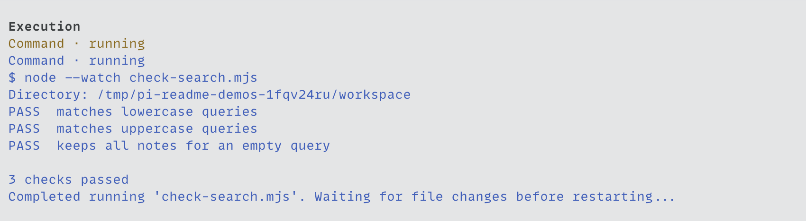

<h1 align="center">pi-codex-tools</h1>

<p align="center">Give GPT the coding tools it expects, inside Pi.</p>

<p align="center">
  <a href="#built-for-gpt">Built for GPT</a> ·
  <a href="#install">Install</a> ·
  <a href="#tools">Tools</a> ·
  <a href="#session-lifetime-and-limits">Session lifetime and limits</a>
</p>

## Built for GPT

OpenAI trains its coding models to use specific tools and formats. Its [Codex guidance](https://developers.openai.com/cookbook/examples/gpt-5/codex_prompting_guide#tools) recommends the patch format used in training and terminal tools with familiar names, arguments, and outputs.

`pi-codex-tools` provides the Codex core tool interface in Pi. The included [tool definitions](src/contract.json) preserve the reference tool names, inputs, instructions, and calling formats for commands, file edits, and local images. The package is built to make use of GPT's existing training and fine-tuning while keeping your Pi sessions, skills, and extensions.



## Install

Use Node.js 24 or later with Pi and `@earendil-works/pi-tui` 1.x (1.1.0 or later). The package also requires `typebox`.

From the repository root:

```bash
pi install ./packages/pi-codex-tools
```

Run `/reload` in an open Pi session. Install [pi-chat](../pi-chat) separately to display each operation in its own row. The tools also work on their own.

## Tools

Ask Pi to work with commands, files, or images as usual. The agent calls `exec` to run JavaScript and `wait` to collect output from an execution that is still running.

Press `Ctrl+O` to expand or collapse tool output (the default binding).

| Tool           | What your agent can do                                                              |
| -------------- | ----------------------------------------------------------------------------------- |
| `exec`         | Coordinate several tool calls in one JavaScript script.                             |
| `wait`         | Collect output from a yielded execution, or stop it.                                |
| `exec_command` | Run shell commands to explore the repo, check changes, or start a terminal session. |
| `write_stdin`  | Send input to a running command or collect its next output.                         |
| `apply_patch`  | Create, update, move, or delete files with structured patches.                      |
| `view_image`   | Inspect local images, including screenshots of your work.                           |

The command, patch, and image helpers run inside `exec`. For example, the agent can check the working tree with:

```js
const result = await tools.exec_command({ cmd: "git status --short" });
text(result);
```

An explicit `shell` selects an installed shell by kind; its supplied path may be ignored even when the file exists. Unknown or unavailable kinds use `/bin/sh` on macOS. Omit `shell` to use Pi's configured shell, including a custom wrapper. Pi's command prefix still applies once.

Helper availability follows Pi's active tool configuration. With Pi's built-in tools, `bash` enables the command helpers, `edit` and `write` together enable patches, and `read` enables images. Each helper can also be enabled by name. Enabled helpers replace the corresponding built-in tools in the model's tool list.

Each script starts with fresh JavaScript variables. Use `store` and `load` to retain serializable values across calls in the same session. A running command can return a `session_id` for `write_stdin`; a running JavaScript execution returns a `cell_id` for `wait`.

Patch results show the changed file paths.



Image results appear inline. Local image arguments are checked before native coercion and after permission hooks edit them. Omitted or null detail defaults to `high`; unknown fields are ignored. Image preparation still has [open alignment gates](../../.scratch/core-tools/issues/05-return-local-images.md) for encoded bytes, detail, and late blocking. Late blocking can leave image bytes in saved results and serialized model output.



## Session lifetime and limits

Running commands, yielded executions, and stored values remain available across prompts in the same Pi session. Switching sessions, reloading extensions, or closing Pi stops this package's running work and clears its temporary state. File changes and saved history remain.

`wait` with `terminate: true` stops the script while already-started commands continue, including during a pending `write_stdin` call. Returned process handles remain usable. Cancelling a later `wait` call leaves the execution and its unread output available.



Commands run with the host's permissions; elevated execution requests are rejected.

Patches validate all operations before writing. A validation failure leaves files unchanged. A failure while applying a patch can leave earlier changes applied.

Live command output can appear before extensions process or redact the final result. Later redaction cannot hide output that was already displayed.

Script failures retain prior output and source locations in `exec_main.mjs`. Custom stack strings and formatters are preserved. Some JSON parser diagnostics still differ from the reference runtime.

See the [tool lifecycle](../../docs/adr/0024-core-tools-use-native-extension-lifecycle.md) and [activity format](../../docs/specs/tool-activity.md) for details.
