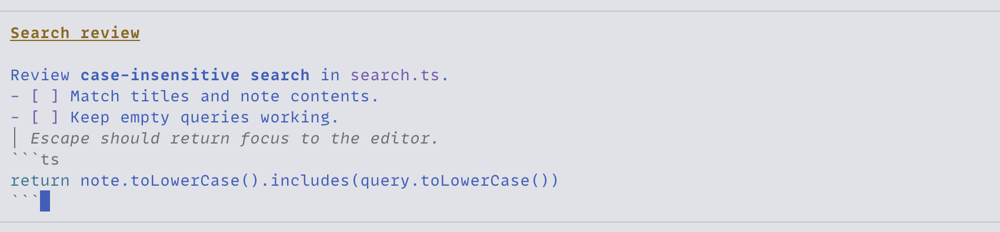
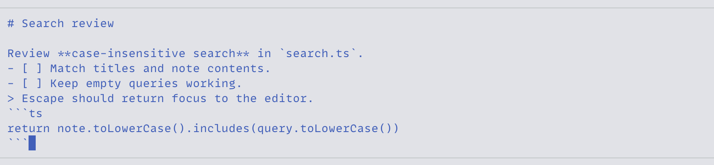
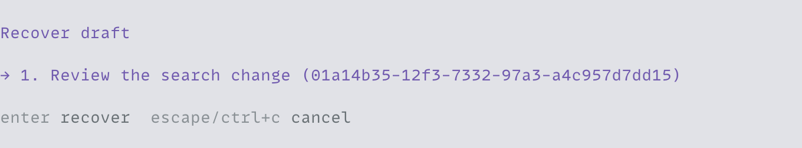

<h1 align="center">pi-composer</h1>

<p align="center">The text editing you expect from a desktop app, inside Pi.</p>

<p align="center">
  <a href="#mouse-and-keyboard">Mouse and keyboard</a> ·
  <a href="#edit-markdown">Live Markdown</a> ·
  <a href="#saved-drafts">Saved drafts</a> ·
  <a href="#works-with-pi">Pi integrations</a> ·
  <a href="#install">Install</a> ·
  <a href="#shortcuts">Shortcuts</a> ·
  <a href="#ghostty-keybindings">Ghostty keybindings</a>
</p>

Click into the middle of a prompt and keep typing. Select a sentence with the mouse, paste its replacement, and undo the change with `Cmd+Z`. Your Markdown formats as you write, and each session keeps its own draft.



## Mouse and keyboard

Mouse and keyboard editing work on the same text and selection, in both formatted and source views. Start a selection by dragging, then extend it with the keyboard. Type or paste to replace it.

| Editing                    | What you can do                                                                                                                                                                                             |
| -------------------------- | ----------------------------------------------------------------------------------------------------------------------------------------------------------------------------------------------------------- |
| Click to edit              | Place the caret with a click and insert text there. Shift+click extends the selection from its anchor.                                                                                                      |
| Select across a long draft | Drag in either direction across wrapped lines. Drag above or below the visible rows to scroll while selecting, or hold Shift while moving by character, word, line, or page.                                |
| Move through your text     | Jump by word, reach either end of a line or the whole draft, and move a visible page at a time. Moving up and down preserves your column across short and wrapped lines.                                    |
| Copy, cut, and paste       | Use the system clipboard at the caret or over a selection. Copy and cut retain the Markdown source. A cut removes the selection only after copying succeeds.                                                |
| Delete and restore         | Delete characters or whole words in either direction, delete to a line boundary, and join adjacent lines. Yank restores text removed by word and line deletion; yank-pop cycles through retained deletions. |
| Undo and redo              | Undo a run of typing as one edit. Replacements, pastes, completions, and external-editor changes share that history. Undo restores the text and selection.                                                  |
| Keep your place            | Scroll without losing the selection. Resize the terminal or switch views and keep editing that range. Typing brings the caret back into view.                                                               |
| Edit Unicode text          | Movement and deletion keep emoji and combining accents whole. Wrapping and vertical movement account for tabs and wide characters.                                                                          |

Enable Show hardware cursor in `/settings` to use your terminal's cursor shape and blinking preferences. Selection highlighting stays visible with either the terminal cursor or the composer's drawn caret.

## Edit Markdown

Read your prompt as a formatted document while you edit it. Headings, bold, italic, strikethrough, links, quotes, nested lists, checklists, and horizontal rules use Pi's Markdown styles. Inline code keeps its literal contents, and fenced code blocks have syntax highlighting.

You can select a word inside bold text and replace it while keeping the surrounding formatting. Press `Cmd+Shift+M` to inspect or edit the Markdown source. Both views share the draft, caret, selection, and undo history, so you can switch in the middle of an edit.



Enter continues lists and fenced code at the caret. Numbered lists get the next number, new checklist items start unchecked, and code keeps its indentation. On an empty list item, Enter removes the list marker. In ordinary prose, Enter submits. Use `Shift+Enter` or `Ctrl+J` for a newline and `Cmd+Enter` to submit from prose, lists, or code. An open completion picker handles its acceptance keys first.

Backspace and Delete edit the Markdown source, including hidden punctuation. For example, Backspace after `**bold**` leaves `**bold*`. Copying and submitting preserve the Markdown source.

In fullscreen Ghostty, `Shift+Cmd+click` opens a link. Absolute file links open in the system's associated application. Opening an attachment uses its saved copy; external edits can change that copy.

## Saved drafts

Leave a prompt unfinished, switch sessions, and pick it up when you return. Each saved session restores its own draft, including file, skill, and attachment references. Edits autosave after 150 ms of idle time and save before a session switch or shutdown.

Undo and redo history stays with its session across switches, working-directory changes, and `/reload`. Restarting Pi restores the saved draft with fresh undo history.

Run `/composer-recover` to recover cleared drafts or text retained after a failed save. Recovery replaces the current draft as an undoable edit and keeps the previous text recoverable. Files live under `pi-composer/drafts` in Pi's agent directory.



With `--no-session`, drafts stay in memory. Pi reports save errors; a failed save cancels a session switch or fork. Content held only in memory is lost when Pi exits.

If a clipboard result arrives after the draft or selection changes, the composer saves the delivered text under `pi-composer/clipboard-recovery` in Pi's agent directory and reports the path. `/composer-recover` retries failed clipboard saves without inserting their text into the current draft.

## Works with Pi

Use Pi's native `@` file and directory completion, slash commands, prompt history, and external editor. Custom completion providers and pickers can insert into the same draft and undo history. Browse an earlier prompt and return to your unfinished draft, or queue a follow-up while the agent is responding. Pi's steering and submission controls keep working.

Add [pi-attachments](../pi-attachments) for saved files and image previews, [pi-quote](../pi-quote) to bring selected conversation text into your draft, or [pi-skill-references](../pi-skill-references) for inline skill completion. Removing or restoring an attachment reference shares the draft's undo history.

For copied files and images, use Pi's clipboard action (`Ctrl+V` by default) with [pi-attachments](../pi-attachments). `Cmd+V` can arrive as a terminal text paste.

## Install

Requires Node.js 24+ and Pi/TUI 1.1.0+ (1.x). From the repository root:

```bash
pi install ./packages/pi-composer
```

Load this before [pi-attachments](../pi-attachments), then run `/reload`. The supported terminal setup is fullscreen Pi in Ghostty on local macOS.

## Shortcuts

| Action                                              | Shortcut                                              |
| --------------------------------------------------- | ----------------------------------------------------- |
| Move by character                                   | `Left/Right`                                          |
| Move by word                                        | `Option+Left/Right`                                   |
| Move to line start/end                              | `Cmd+Left/Right`                                      |
| Move to draft start/end                             | `Cmd+Up/Down`                                         |
| Extend a selection                                  | Hold Shift with a movement shortcut, or Shift+click   |
| Move by a visible page                              | `PageUp/PageDown` when delivered to the editor        |
| Extend selection by a page                          | `Shift+PageUp/PageDown` (`Shift+Fn+Up/Down` on a Mac) |
| Select all                                          | `Cmd+A`                                               |
| Copy selection                                      | `Cmd+C`                                               |
| Cut selection                                       | `Cmd+X`                                               |
| Paste                                               | `Ctrl+V` or `Cmd+V`                                   |
| Delete backward/forward                             | `Backspace`; forward `Delete` or `Ctrl+D`             |
| Delete the previous word                            | `Ctrl+W` or `Option+Backspace`                        |
| Delete the next word                                | `Option+D` or `Option+Delete`                         |
| Delete to line start/end                            | `Ctrl+U` / `Ctrl+K`                                   |
| Restore a word or line deletion                     | `Ctrl+Y`; `Option+Y` cycles retained deletions        |
| Jump to the next/previous occurrence of a character | `Ctrl+]` / `Ctrl+Alt+]`, then type the character      |
| Undo                                                | `Ctrl+-` or `Cmd+Z`                                   |
| Redo                                                | `Cmd+Shift+Z`                                         |
| Toggle formatted/source view                        | `Cmd+Shift+M`                                         |
| Insert a newline                                    | `Shift+Enter` or `Ctrl+J`                             |
| Submit from prose, lists, or code                   | `Cmd+Enter`                                           |

Cmd shortcuts require the terminal to forward them and yield to Pi bindings and extension shortcuts. Remapping or disabling a native action also disables its Cmd alias. Use `/hotkeys` for Pi's native shortcuts. On a Mac keyboard, the key labeled Delete sends Backspace; forward Delete is a separate action.

## Ghostty keybindings

Run `/setup-keybinds ghostty` inside Ghostty to review and install forwarding for Cmd+A, Cmd+Enter, Cmd+Up/Down, Cmd+Z, Cmd+Shift+Z, and Shift+Fn+Up/Down. Setup shows the target file and asks for confirmation before adding one marked block.

Setup requires Ghostty 1.3.1 on local macOS, the native U.S. keyboard layout, and a single Application Support configuration. Includes, modifier remapping, and extra Ghostty launch arguments require manual setup.

The bindings also affect other programs and stay installed after Pi exits. Use Ghostty's Reload Configuration action after installation or removal. Run `/setup-keybinds ghostty remove` to remove the unchanged managed block. An edited or incomplete block needs manual resolution.

See the [setup requirements](../../docs/specs/pi-composer.md#ghostty-keybinding-setup) and [full specification](../../docs/specs/pi-composer.md).
