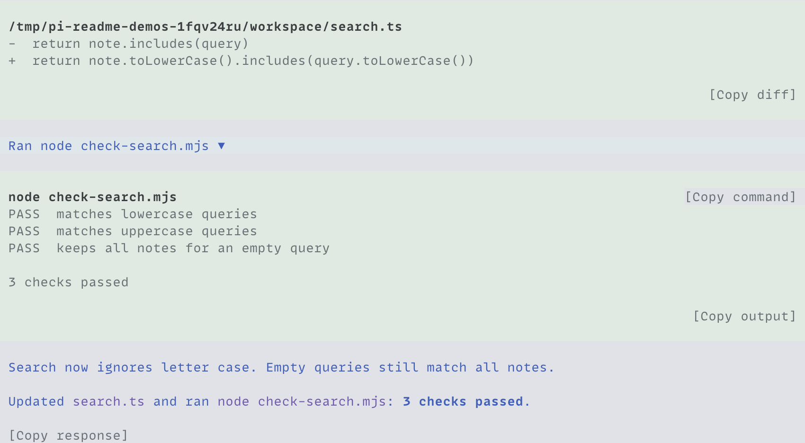

<h1 align="center">pi-copy</h1>

<p align="center">Copy commands, output, diffs, and final responses from Pi in one click, preserving the original Markdown and whitespace.</p>

<p align="center">
  <a href="#install">Install</a> ·
  <a href="#copy-text">Copy text</a> ·
  <a href="#what-gets-copied">What gets copied</a>
</p>



Shown with [pi-chat](../pi-chat) and [pi-codex-tools](../pi-codex-tools).

## Install

Requires Node.js 24+ and Pi/TUI 1.1.0+ (1.x). From the repository root:

```bash
pi install ./packages/pi-copy
```

Run `/reload` in an open Pi session. `pi-copy` works with native Pi and [pi-chat](../pi-chat). Install chat separately if you want grouped activity; either load order works.

## Copy text

Click a copy control in a command or edit panel, or below a completed final response. With `pi-chat`, expand the group and item to see command and result controls.

| Control       | Copies                                                    |
| ------------- | --------------------------------------------------------- |
| Copy command  | The command text.                                         |
| Copy output   | The text output Pi still has for that command or edit.    |
| Copy diff     | The edit's retained patch or diff, when one is available. |
| Copy response | The final response's original Markdown.                   |

In native Pi, `Alt+G` focuses a nearby control. Use Up/Down to move between controls, Enter to copy, and Escape to return to the editor. Your configured selector keys take priority. With `pi-chat`, copy controls share the group and item navigation.

## What gets copied

Controls use the retained source, preserving its Markdown and whitespace. Terminal styling and the controls themselves stay out of copied text. Copy response excludes thoughts, commentary, and tool activity.

Empty results leave the clipboard unchanged. A successful copy briefly shows Copied. Pi reports clipboard failures in its status display and warns when the copied output is incomplete. Copying does not recover discarded output.

See the [specification](../../docs/specs/pi-copy.md) for source and placement rules.
