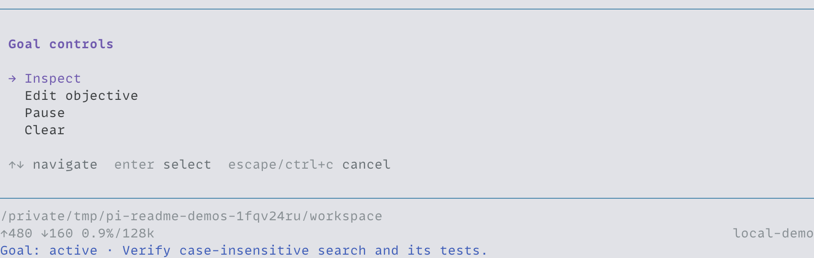
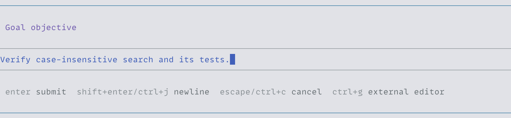
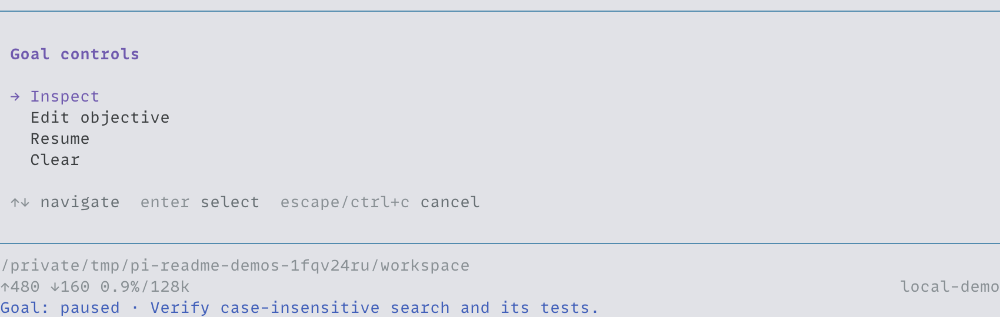
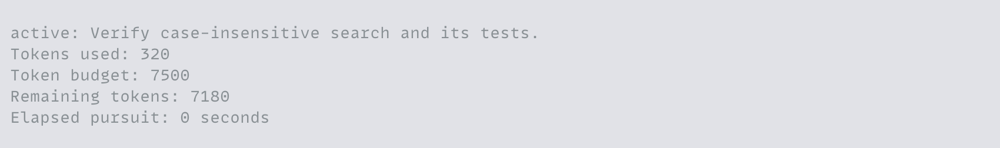

<h1 align="center">pi-goal</h1>

<p align="center">Keep Pi working toward an explicit goal across turns, with pause controls and optional token budgets.</p>

<p align="center">
  <a href="#install">Install</a> ·
  <a href="#manage-a-goal">Manage a goal</a> ·
  <a href="#budgets-and-persistence">Budgets and persistence</a>
</p>



## Install

Requires Node.js 24+ and Pi 1.1.0+ (1.x). From the repository root:

```bash
pi install ./packages/pi-goal
```

Run `/reload` in an open Pi session. Goals require session persistence and are unavailable with `--no-session`.

## Manage a goal

Run `/goal` to open the controls, or use a command directly:

| Command                    | Action                                                             |
| -------------------------- | ------------------------------------------------------------------ |
| `/goal inspect`            | Show the objective, status, token usage, budget, and elapsed time. |
| `/goal create <objective>` | Start a goal without a token budget.                               |
| `/goal edit <objective>`   | Change the objective, keep usage, and resume if budget remains.    |
| `/goal pause`              | Prevent further automatic turns.                                   |
| `/goal resume`             | Resume a paused, blocked, or usage-limited goal.                   |
| `/goal clear`              | Remove the current goal and cancel its pending continuation.       |

You can also explicitly ask the agent to create a goal. An ordinary task does not authorize one. There is one current goal per session; an unfinished goal must be cleared before another replaces it.

Run `/goal create` or `/goal edit` without an objective to open the editor.



While a goal is active, Pi starts another turn when the session is idle and no messages are queued. `/goal pause` lets the current turn finish. Pi's Stop action pauses the goal and interrupts the response. Completion ends automatic pursuit.



The agent uses `get_goal`, `create_goal`, and `update_goal` to inspect, create, and update goals.

The agent is instructed to mark a goal complete only after finishing the whole objective. It can mark a goal blocked when the same obstacle prevents progress for at least three consecutive goal turns and requires your input or an external change. Terminal errors and repeated empty turns can also block a goal. A confirmed provider quota failure makes it usage-limited. Resolve the cause, then run `/goal resume` to try again.

## Budgets and persistence

To set a token budget, explicitly ask the agent to create the goal with that budget. For example:

> Create a goal to verify case-insensitive search and its tests, with a budget of 7,500 tokens.

Usage counts reported input, cache-write, and output tokens. Cached reads are excluded, and reasoning already included in output is not counted again. Reported tool and compaction usage also count.

Budgets are soft limits: work already running can exceed the allowance before its usage is recorded. Resuming or editing preserves spent tokens and the original budget. A goal with an exhausted budget cannot resume.



Goal state is saved with the Pi session. Compaction and history navigation preserve the current goal and its usage. Ordinary forks start without a goal.

Automatic pursuit runs only while that session is loaded. Reopening a saved active goal can resume work. Elapsed time excludes pauses and time while the session is closed.

A goal created before the first user or assistant message can be lost if Pi exits before saving. Use one Pi process per session.

Storage errors stop automatic pursuit, including across `/reload`. Reopen the saved session to recover the state Pi wrote.

See the [specification](../../docs/specs/pi-goal.md) for accounting and lifecycle rules.
