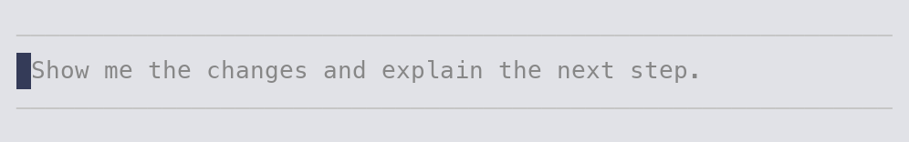
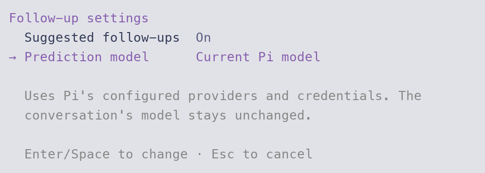

<h1 align="center">pi-predict</h1>

<p align="center">Predict your next message inside the composer. Press Tab to make it a draft.</p>

<p align="center">
  <a href="#install">Install</a> ·
  <a href="#use-a-prediction">Use a prediction</a> ·
  <a href="#settings">Settings</a> ·
  <a href="#context-and-prompt">Context and prompt</a>
</p>



## Install

Requires Node.js 24+ and Pi/TUI 1.1.0+ (1.x). From the repository root:

```bash
pi install ./packages/pi-predict
```

Run `/reload` in an open Pi session.

Works with vanilla Pi and [pi-composer](../pi-composer) in regular and fullscreen modes. Install in either order; suggestions follow later composer replacements automatically. No other package from this repository is required. Compatibility is verified against Pi/TUI 1.1.0; later Pi releases may require an extension update.

## Use a prediction

After a successful response, one suggested next message can appear as faint text in the empty composer.

| Action             | Result                                                                                   |
| ------------------ | ---------------------------------------------------------------------------------------- |
| **Tab**            | Insert the visible suggestion as an ordinary, editable draft.                            |
| **Escape**         | Dismiss it for that response.                                                            |
| Start typing       | Hide it while keeping your own text. Clearing the draft reveals the retained suggestion. |
| **Undo** after Tab | Remove the insertion through the active composer's normal undo action.                   |

Acceptance never submits the message. Press your usual Send key when the draft is ready. Suggestions stay out of draft recovery and conversation history until accepted and submitted. Completion menus and dialogs keep their normal keyboard behavior.

Long suggestions show a shortened, single-line preview; Tab inserts the whole message, including line breaks. No prediction is generated after an aborted or failed response. Failed predictions report an error and are not retried automatically.

Other composers can work through the same adapter when they follow Pi's focused-editor, cursor-marker, and insertion conventions. A composer that cannot be decorated stays selected and receives a compatibility notice.

## Settings

Run `/predict` to open Pi's native settings controls.



- **Suggested follow-ups:** turn background predictions on or off.
- **Prediction model:** inherit the current Pi model, or search available models by provider, ID, or display name. Selecting one leaves the conversation's model unchanged.

Providers and credentials come from Pi. Configure them through Pi's normal model configuration and `/login`. Predictions send the conversation to the selected provider and use that provider's normal quota and pricing.

Preferences live in `pi-predict.json` in Pi's active agent directory, normally `~/.pi/agent/`. Defaults are:

```json
{
  "enabled": true,
  "model": null
}
```

For a separate model, set `model` to `{"provider": "your-provider", "id": "your-model"}`. Manual file edits take effect after `/reload`. A failed save leaves the previous setting active. There is no entry in Pi's central `/settings` menu.

## Context and prompt

Predictions use the complete effective Pi conversation, including instructions, tool declarations, tool results, and images permitted by Pi. The prediction request cannot execute tools. It does not retrieve extra files or app content, shorten history to fit a smaller model, or substitute a different model on failure.

The bundled Codex reference prompt is version **5**, supplied on 2026-10-20. Its exact text, reference date, SHA-256 hash, and **high** reasoning setting are readable in [src/prompt.ts](src/prompt.ts). It requests one natural next user message of at most 240 characters, or no suggestion when the conversation gives no grounded next move. The request appends the Codex client's nullable-string JSON schema.

Running this extension requires only Pi and the chosen provider. It does not contact Codex or require a Codex login. Reference updates are deliberate source changes; the [reference record](../../docs/plans/composer-predictions.md#exact-prompt-status) documents the supplied configuration and verification.

The images above show actual Pi rendering with a controlled provider response. See the [specification](../../docs/specs/pi-predict.md) for context capture, compatibility, and verification limits.
