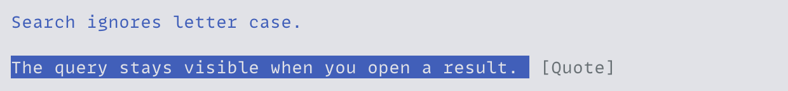
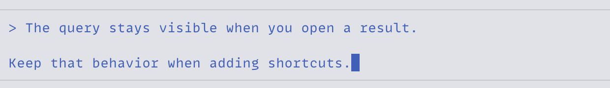

<h1 align="center">pi-quote</h1>

<p align="center">Quote selected conversation text into your Pi draft.</p>

<p align="center">
  <a href="#install">Install</a> ·
  <a href="#quote-text">Quote text</a> ·
  <a href="#quoted-content">Quoted content</a>
</p>



## Install

Requires Node.js 24+ and Pi/TUI 1.1.0+ (1.x). From the repository root:

```bash
pi install ./packages/pi-quote
```

Run `/reload` in an open Pi session. Quoting requires Pi's fullscreen mode, which you can select in `/settings`.

The extension works with native Pi and with [pi-chat](../pi-chat), [pi-composer](../pi-composer), and [pi-attachments](../pi-attachments). It can load before or after those extensions. Compatibility is verified against Pi/TUI 1.1.0; later Pi releases may require an extension update.

## Quote text

1. Highlight conversation text.
2. Click [Quote] near the selection or above the editor. `Alt+Shift+Q` also works when the terminal sends that shortcut.
3. Write your reply below the inserted quote and submit when ready.



Press Escape to dismiss the quote control. The quote goes at the caret or replaces selected text in your draft, with a blank line afterward for your reply. Surrounding text stays intact. One undo restores the draft.

## Quoted content

Each selected line becomes a Markdown blockquote, including blank lines. Selections inside visible code fences keep fenced formatting. Large quotes stay inline with `pi-attachments` enabled.

Quotes contain Pi's rendered text, including displayed wrapping and normalized whitespace. Hidden Markdown syntax and link destinations are not recovered, and images themselves are not quoted.

See the [specification](../../docs/specs/pi-quote.md) for selection and formatting behavior.
