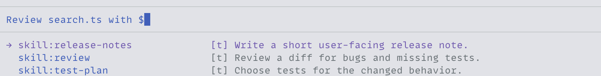

<h1 align="center">pi-skill-references</h1>

<p align="center">Choose Pi skills while writing a prompt and include their instructions when you send it.</p>

<p align="center">
  <a href="#install">Install</a> ·
  <a href="#reference-a-skill">Reference a skill</a> ·
  <a href="#when-you-send-a-prompt">When you send a prompt</a>
</p>

Pi's built-in `/skill:name` command works only at the start of a prompt. This extension lets you reference skills anywhere in your prompt's prose and combine several skills in one request.



Shown with [pi-composer](../pi-composer).

## Install

Use Node.js 24+ with Pi and `@earendil-works/pi-tui` 1.1.0+ (1.x). Install from the repository root:

```bash
pi install ./packages/pi-skill-references
```

Run `/reload` in an open Pi session. The extension works with Pi's native editor and [pi-composer](../pi-composer).

## Reference a skill

Type `$` or `/` in prose and choose a configured skill. Completion inserts its `/skill:name` reference. Inline `/` completion opens with Tab in the native editor and automatically in `pi-composer`.

For a configured skill named `review`, you can also type or paste the reference:

```text
Please apply /skill:review to this change.
```


References remain editable text in your draft and prompt history. Shorthand such as `$review` stays literal until you select a completion.

## When you send a prompt

The agent receives each resolved skill's instructions once per prompt, in order of first mention. Repeated references and aliases for the same skill file share one instruction block. Each block tells the agent which directory to use for the skill's relative paths. Resolution uses Pi's configured skill catalog.

Code, escaped references, URLs, paths, and link destinations stay literal. Unknown references remain unchanged. Leading slash commands keep Pi's normal dispatch.

Pi trims leading whitespace before processing input, so use fenced code for literal examples at the start of a prompt.

If Pi cannot read a skill file, it reports the error and omits that skill's instructions. Your reference stays in the prompt.

See the [specification](../../docs/specs/pi-skill-references.md) for completion and resolution rules.
